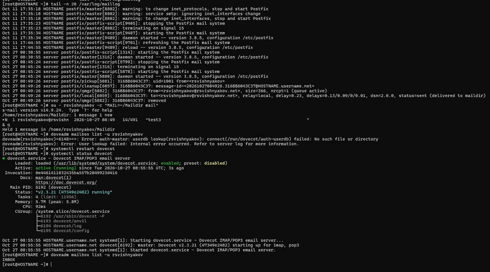
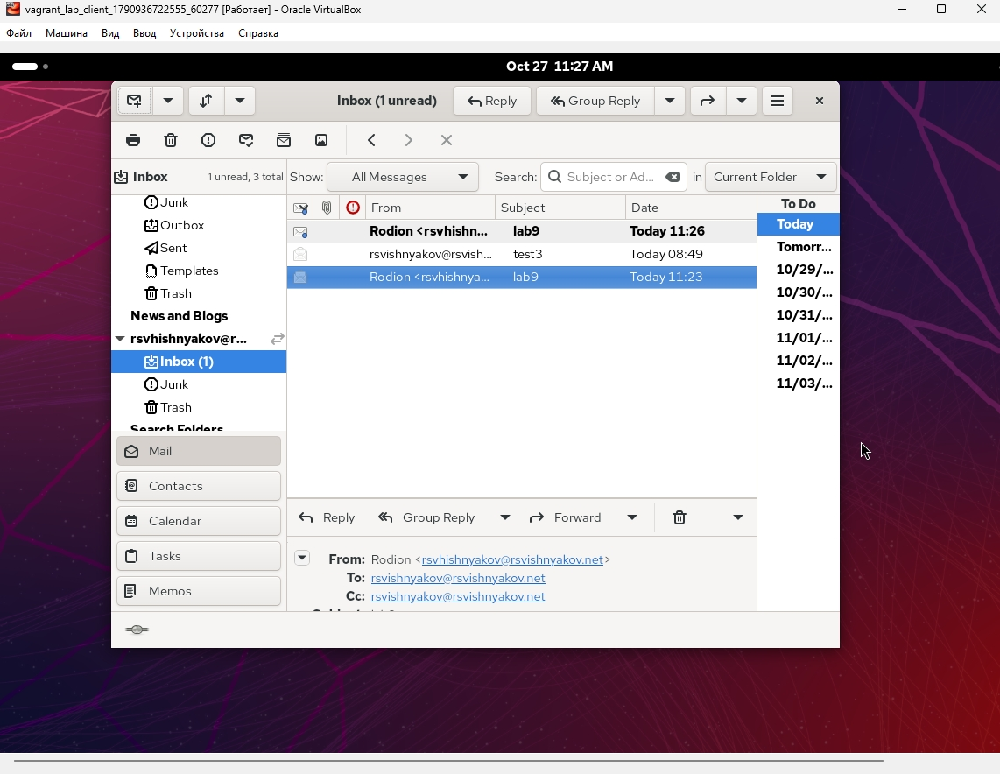
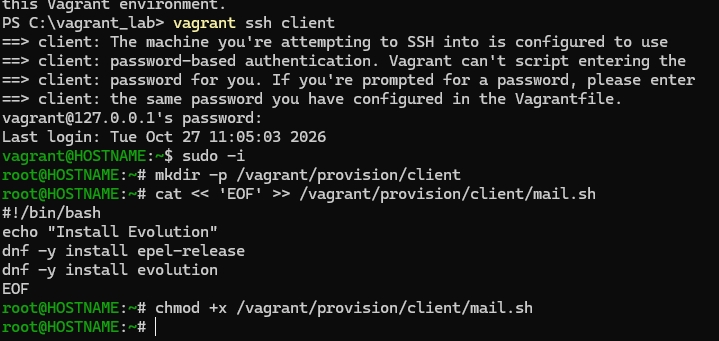

---
## Front matter
lang: ru-RU
title: Презентация по лабораторной работе 9
subtitle: Настройка POP3/IMAP сервера
author:
  - Вишняков Родион Сергеевич
institute:
  - Российский университет дружбы народов, Москва, Россия
date: 30 октября 2026

## i18n babel
babel-lang: russian
babel-otherlangs: english

## Formatting pdf
toc: false
toc-title: Содержание
slide_level: 2
aspectratio: 169
section-titles: true
theme: Madrid
---

# Цели и задачи работы

## Цель лабораторной работы

Приобретение практических навыков по установке и простейшему конфигурированию POP3/IMAP-сервера.

# Процесс выполнения лабораторной работы

## Установка пакетов telnet и dovecot на виртуальной машине server с помощью пакетного менеджера dnf. Процесс загрузки и установки завершен успешно.

{ #fig:001 width=70% height=70% }

## Редактирование конфигурационных файлов Dovecot. В dovecot.conf включены протоколы imap и pop3. В 10-auth.conf задан метод аутентификации plain. В auth-system.conf.ext проверено использование драйверов pam и passwd. В 10-mail.conf настроено расположение почтовых ящиков maildir:~/Maildir. Postfix также настроен на использование каталога Maildir/.

{ #fig:002 width=70% height=70% }

## Настройка межсетевого экрана (firewalld). Добавлены разрешающие правила для протоколов pop3, pop3s, imap и imaps на постоянной основе (--permanent). После этого контекст безопасности SELinux восстановлен командой restorecon, и служба Dovecot успешно запущена.

{ #fig:002 width=70% height=70% }

## Мониторинг логов почтовой службы (tail -n 20 /var/log/maillog) и просмотр тестового письма локально с помощью утилиты mail. Также показан успешный вывод команды doveadm mailbox list, отображающий папку INBOX после перезапуска службы Dovecot.

{ #fig:003 width=70% height=70% }

## Проверка работы POP3 сервера через утилиту telnet. Выполнено подключение к порту 110 сервера mail.rsvishnyakov.net, успешная авторизация пользователя rsvishnyakov и просмотр содержимого первого письма командой retr 1.
 
{ #fig:001 width=70% height=70% }

## Окно настройки "Account Summary" в графическом почтовом клиенте Evolution на клиентской машине. Заданы параметры для приема (IMAP, сервер mail.rsvishnyakov.net, STARTTLS) и отправки (SMTP) почты для пользователя rsvishnyakov.

{ #fig:002 width=70% height=70% }

## Интерфейс почтового клиента Evolution на клиентской машине. В папке "Входящие" (Inbox) отображается успешно полученное тестовое письмо с темой "lab9", что подтверждает корректную работу связки Postfix и Dovecot.

{ #fig:003 width=70% height=70% }

##  Внесение изменений в скрипт mail.sh на сервере для автоматизации развертывания. Копируются конфигурационные файлы Dovecot, добавляются команды для установки пакетов, настройки брандмауэра для POP3/IMAP, настройки Postfix для использования Maildir, а также перезапуска служб.
 
{ #fig:001 width=70% height=70% }

## Редактирование скрипта инициализации mail.sh на клиентской машине. Добавлены команды для автоматической установки репозитория epel-release и почтового клиента evolution при развертывании виртуальной машины client.

{ #fig:001 width=70% height=70% }

# Выводы по проделанной работе

## Вывод

Мы приобрели практические навыки по установке и простейшему конфигурированию POP3/IMAP-сервера.
