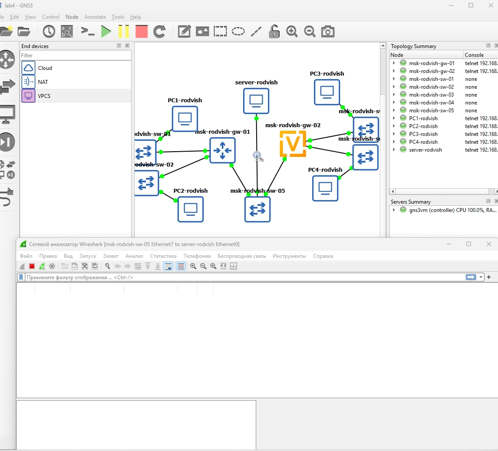
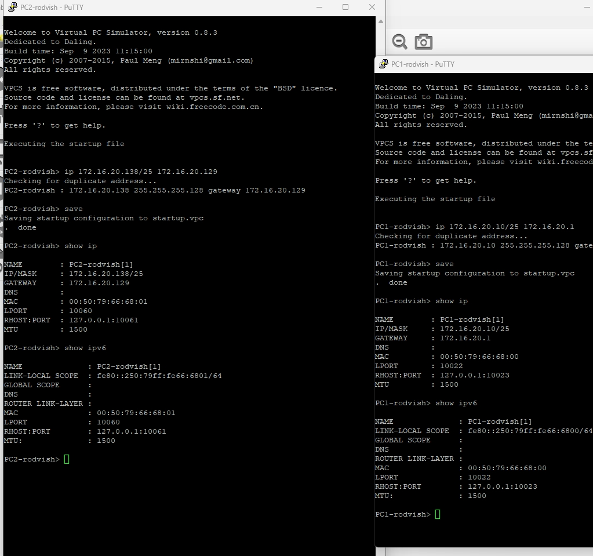
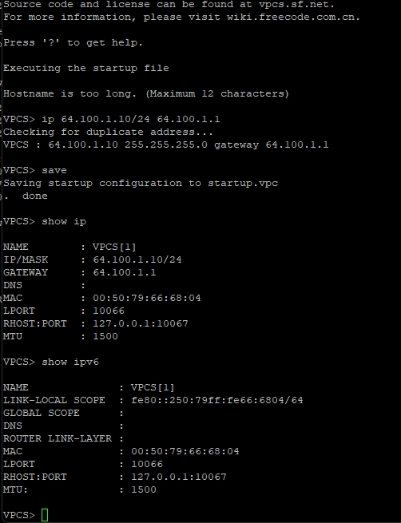
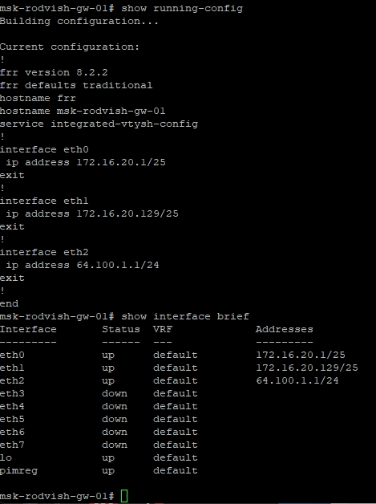
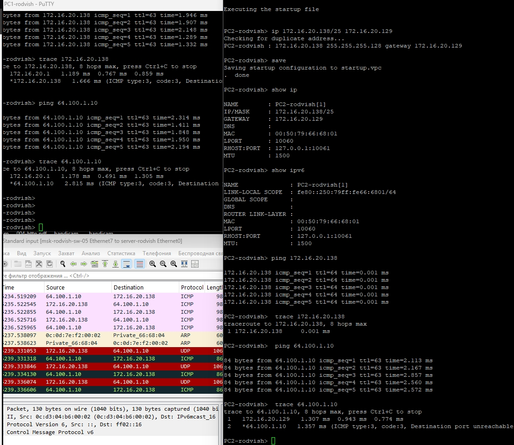
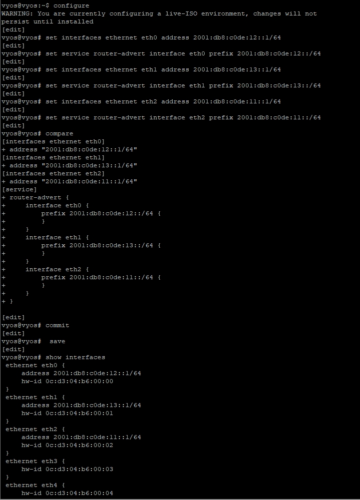

---
## Front matter
lang: ru-RU
title: Презентация по лабораторной работе 4
subtitle: Адресация IPv4 и IPv6. Двойной стека
author:
  - Вишняков Родион Сергеевич
institute:
  - Российский университет дружбы народов, Москва, Россия
date: 24 октября 2026

## i18n babel
babel-lang: russian
babel-otherlangs: english

## Formatting pdf
toc: false
toc-title: Содержание
slide_level: 2
aspectratio: 169
section-titles: true
theme: Madrid
---

# Цели и задачи работы

## Цель лабораторной работы

Изучение принципов распределения и настройки адресного пространства на устройствах сети.

# Процесс выполнения лабораторной работы

## Рабочая область эмулятора GNS3 с собранной топологией сети с двойным стеком протоколов. В левой части реализована подсеть IPv4 с маршрутизатором FRR, в правой — подсеть IPv6 с маршрутизатором VyOS, а в центре находится сервер с двойным стеком. В нижней части окна запущен процесс захвата трафика Wireshark.

{ #fig:001 width=70% height=70% }

## Консоли терминалов виртуальных компьютеров PC1 и PC2. Продемонстрирован процесс назначения IPv4-адресов и шлюзов по умолчанию с помощью команды `ip`, а также проверка примененных сетевых настроек командами `show ip` и `show ipv6`.

{ #fig:002 width=70% height=70% }

## Консоль центрального сервера (VPCS). Выполнена настройка IPv4-адреса и шлюза по умолчанию для подсети 64.100.1.0/24. Успешность настройки подтверждена выводом команды `show ip`.

{ #fig:002 width=70% height=70% }

## Консоль маршрутизатора FRR (`msk-rodvish-gw-01`). Показан процесс конфигурации интерфейсов `eth0`, `eth1` и `eth2`: назначение им соответствующих IPv4-адресов, включение портов командой `no shutdown` и сохранение конфигурации в память.

{ #fig:003 width=70% height=70% }

## Проверка текущей конфигурации маршрутизатора FRR (`msk-rodvish-gw-01`). С помощью команды `show interface brief` подтверждается, что настроенные интерфейсы `eth0`, `eth1` и `eth2` находятся в активном состоянии (up) и имеют верные IPv4-адреса. 
 
{ #fig:001 width=70% height=70% }

## Проверка связности узлов в подсети IPv4. В консолях PC1 и PC2 успешно выполняются команды `ping` и `trace` до соседних компьютеров и сервера. Также на фоне виден перехваченный ICMP-трафик в Wireshark.

{ #fig:002 width=70% height=70% }

## Консоли виртуальных компьютеров PC3, PC4 и сервера. На данных узлах выполнена настройка глобальных IPv6-адресов (2001:db8:c0de...). Корректность применения адресов проверена командой `show ipv6`.

{ #fig:003 width=70% height=70% }

## Консоль маршрутизатора VyOS. Выполнена конфигурация интерфейсов `eth0`, `eth1` и `eth2`: назначены IPv6-адреса и настроена служба Router Advert (рассылка префиксов) для каждой подсети. Настройки успешно применены командой `commit`, сохранены и проверены через `show interfaces`.

{ #fig:001 width=70% height=70% }

# Выводы по проделанной работе

## Вывод

Мы изучили принципы распределения и настройки адресного пространства на устройствах сети.

