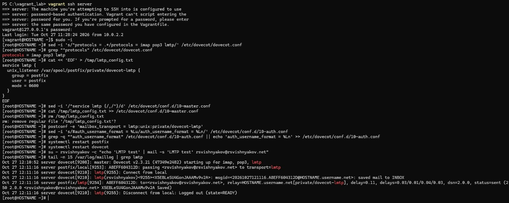
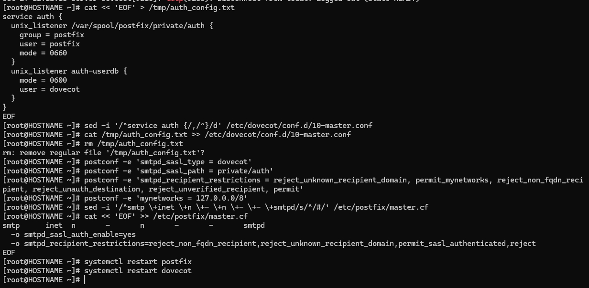
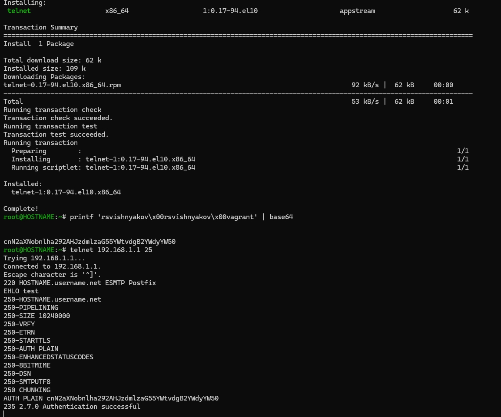
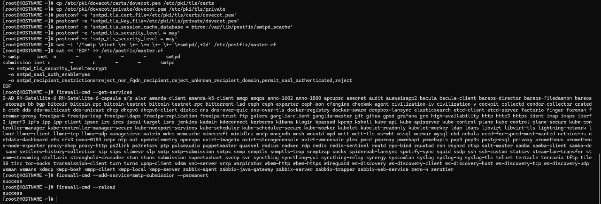
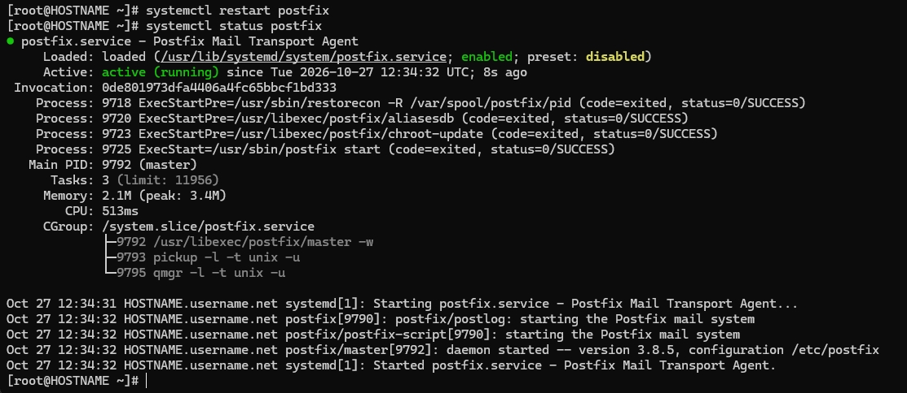
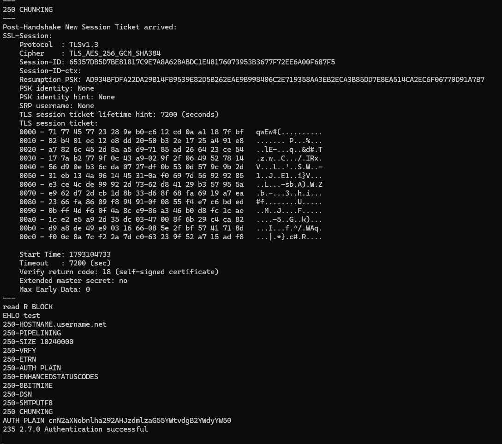
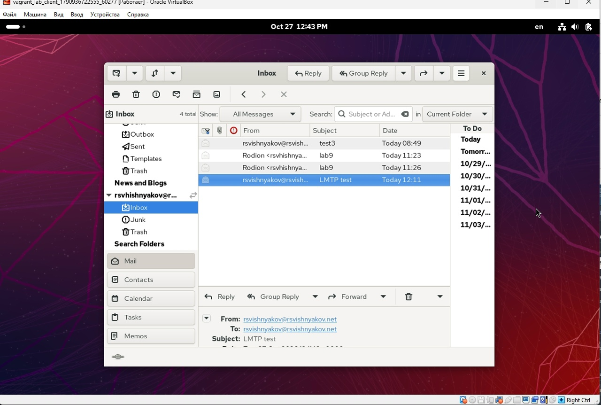
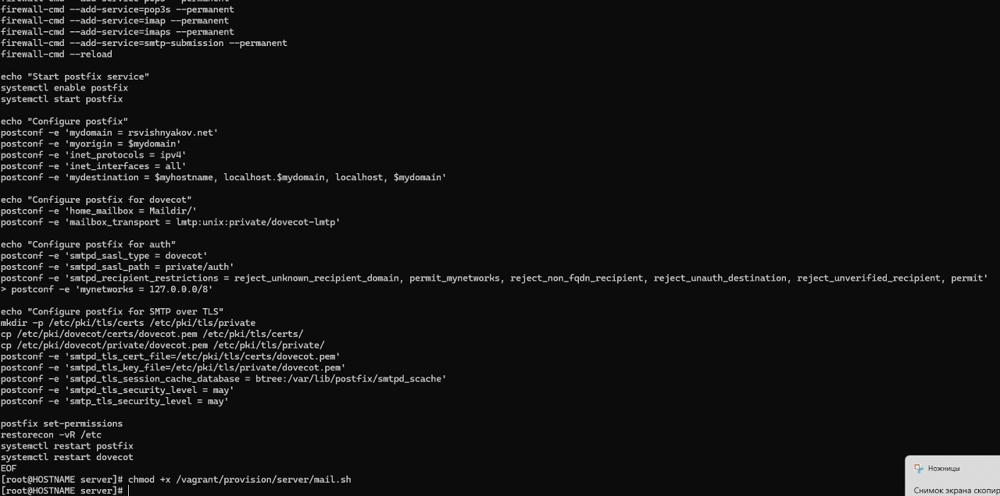
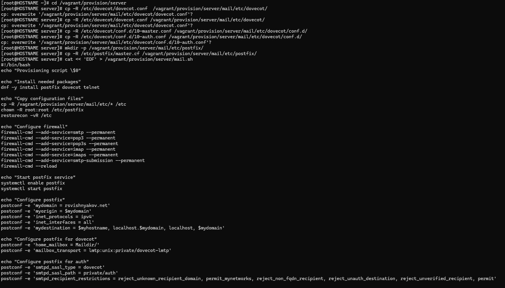

---
## Front matter
title: "Отчёт по лабораторной работе 10"
subtitle: "Расширенные настройки SMTP-сервера"
author: "Вишняков Родион Сергеевич"

## Generic otions
lang: ru-RU
toc-title: "Содержание"

## Bibliography

## Pdf output format
toc: true # Table of contents
toc-depth: 2
lof: true # List of figures
lot: true # List of tables
fontsize: 12pt
linestretch: 1.5
papersize: a4
documentclass: scrreprt
## I18n polyglossia
polyglossia-lang:
  name: russian
  options:
	- spelling=modern
	- babelshorthands=true
polyglossia-otherlangs:
  name: english
## I18n babel
babel-lang: russian
babel-otherlangs: english
## Fonts
mainfont: IBM Plex Serif
romanfont: IBM Plex Serif
sansfont: IBM Plex Sans
monofont: IBM Plex Mono
mathfont: STIX Two Math
mainfontoptions: Ligatures=Common,Ligatures=TeX,Scale=0.94
romanfontoptions: Ligatures=Common,Ligatures=TeX,Scale=0.94
sansfontoptions: Ligatures=Common,Ligatures=TeX,Scale=MatchLowercase,Scale=0.94
monofontoptions: Scale=MatchLowercase,Scale=0.94,FakeStretch=0.9
mathfontoptions:
## Biblatex
  - parentracker=true
  - backend=biber
  - hyperref=auto
  - language=auto
  - autolang=other*
  - citestyle=gost-numeric
## Pandoc-crossref LaTeX customization
figureTitle: "Рис."
tableTitle: "Таблица"
listingTitle: "Листинг"
lofTitle: "Список иллюстраций"
lotTitle: "Список таблиц"
lolTitle: "Листинги"
## Misc options
indent: true
header-includes:
  - \usepackage{indentfirst}
  - \usepackage{float} # keep figures where there are in the text
  - \floatplacement{figure}{H} # keep figures where there are in the text
---

# Цель работы

Приобретение практических навыков по конфигурированию SMTP-сервера в части настройки аутентификации.

# Выполнение лабораторной работы

Настройка протокола LMTP в Dovecot и Postfix. Показано включение протокола `lmtp` в `dovecot.conf`, создание UNIX-сокета, а также успешная проверка локальной доставки тестового письма "LMTP test" (в логах `maillog` виден статус `relay=dovecot-lmtp`).

{ #fig:001 width=70% height=70% }

Настройка SMTP-аутентификации (SASL). Выполнено создание сокета `auth` в конфигурации Dovecot для передачи данных аутентификации в Postfix, заданы параметры `smtpd_sasl_type` и ограничения в Postfix, а также включена аутентификация в `master.cf`.

{ #fig:002 width=70% height=70% }

Проверка работы SMTP-аутентификации. Сгенерирована строка аутентификации в формате base64, выполнено подключение к 25 порту через `telnet` и успешно пройдена авторизация (ответ сервера `235 2.7.0 Authentication successful`).

{ #fig:002 width=70% height=70% }

Настройка SMTP over TLS. Произведено копирование SSL-сертификатов, указаны пути к ним в настройках Postfix, включена служба `submission` (порт 587) в `master.cf` и добавлено правило в межсетевой экран для `smtp-submission`.

{ #fig:003 width=70% height=70% }

Перезапуск почтовой службы. Показан успешный перезапуск Postfix и вывод команды `systemctl status postfix`, подтверждающий, что служба активна (`running`) после внесения настроек TLS.
 
{ #fig:001 width=70% height=70% }

Тестирование SMTP over TLS с клиентской машины. Выполнено защищенное подключение к порту 587 с помощью утилиты `openssl` (виден блок параметров установленной TLS-сессии) и успешно пройдена проверка аутентификации командой `AUTH PLAIN`.

{ #fig:002 width=70% height=70% }

Проверка доставки в почтовом клиенте Evolution. В графическом интерфейсе почтового клиента на виртуальной машине `client` отображается папка «Входящие» (Inbox) с полученными письмами, включая письмо с темой "LMTP test"

{ #fig:003 width=70% height=70% }

Внесение изменений во внутреннее окружение Vagrant (начало). Показан процесс копирования измененных конфигурационных файлов в общую папку `/vagrant/provision/server/` и начало записи команд в скрипт автоматического развертывания `mail.sh`.

{ #fig:001 width=70% height=70% }

Завершение создания скрипта развертывания. Показана вторая часть скрипта `mail.sh`, включающая конфигурацию Postfix для LMTP, SASL-аутентификации и TLS, а также применение прав на исполнение скрипта командой `chmod +x`.

{ #fig:001 width=70% height=70% }

# Вывод

Мы приобрели практические навыки по конфигурированию SMTP-сервера в части настройки аутентификации.

# Контрольные вопросы

1. Приведите пример задания формата аутентификации пользователя в Dovecot в форме логина с указанием домена.

Ответ: Для аутентификации с указанием домена в конфигурационном файле `10-auth.conf` используется переменная `%u` (или `%Lu` для приведения к нижнему регистру). Пример: `auth_username_format = %u`. *(В отличие от `%Ln`, который отбрасывает домен)*.

2. Какие функции выполняет почтовый Relay-сервер?

Ответ: Он выполняет функцию транзитного узла (посредника). Relay-сервер принимает электронные сообщения от отправителя или другого сервера и пересылает (маршрутизирует) их дальше — на конечный почтовый сервер получателя.

3. Какие угрозы безопасности могут возникнуть в случае настройки почтового сервера как Relay-сервера?

Ответ: Если сервер настроен некорректно (как открытый релей — Open Relay без строгой аутентификации), злоумышленники и спамеры смогут анонимно рассылать через него массовый спам и вредоносное ПО. Это быстро приведет к занесению IP-адреса сервера в глобальные черные списки (блэклисты) и блокировке всей легитимной почты.
